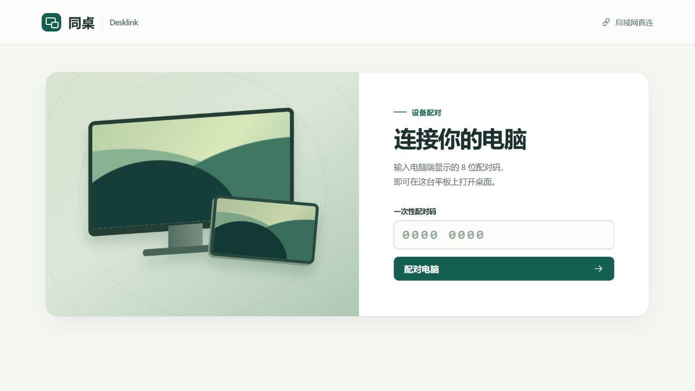
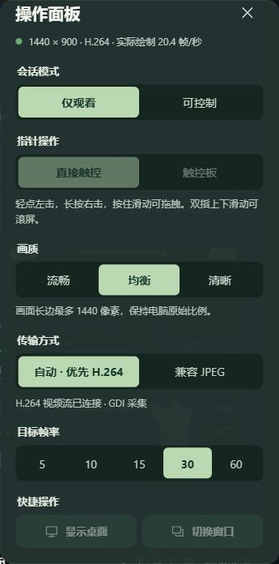

# 同桌 Desklink

**用平板浏览器，操作同一局域网里的 Windows 电脑。**

电脑放在宿舍，手边只有平板，也可以打开电脑里的课件、改两行报告，或切回正在运行的桌面程序。只要两台设备的网络允许互访，在电脑上启动同桌，平板打开它给出的地址，输入一次性配对码，就能看到并操作 Windows 主屏。整个过程无需注册账号、订阅服务或部署中转服务器。

[下载 Windows 版](https://github.com/xm-3599/Desklink/releases/tag/v0.1.0) · [第一次连接](#第一次连接) · [画质与实测](#画质与实测) · [从源码构建](#从源码构建)



## 第一次连接

电脑需要 Windows 10 或 11、.NET Framework 4.8，以及已登录并解锁的桌面。平板使用近期版本的浏览器。两端都需支持 IPv4，且平板能访问电脑选定的地址。

1. 从发行页下载 `Desklink-v0.1.0-Windows.zip`，解压并打开 `Desklink.exe`。选择接入校园网或家庭局域网的网卡，点 **开始共享**。
2. 在平板浏览器输入电脑显示的完整地址，包括 `https://` 和端口 `:49731`。首次访问可能出现本机证书提示。在电脑端点 **证书指纹**，与平板浏览器证书详情中的 SHA-256 指纹核对，一致后继续。若浏览器无法显示指纹，请使用能查看证书详情的浏览器。
3. 输入电脑上显示的 **8 位配对码**，点选电脑，再选 **进入桌面** 或 **仅观看**。电脑端窗口可以最小化。使用结束时点 **停止共享**，即可断开连接。

## 平板上能做什么

| 想做的事 | 操作方法 |
| --- | --- |
| 点课件、拖窗口 | 直接触控模式下，轻点左击，长按右击，按下后滑动可拖拽，双指上下滑动可滚屏。 |
| 精确点中小按钮 | 在右侧 **操作** 面板切换到 **触控板**，单指滑动移动鼠标，再轻点点击当前位置。 |
| 在 Windows 应用里输入中文 | 先点选电脑上的输入框，再打开侧栏 **键盘**。用平板输入法写好文字，点 **发送文字**。 |
| 切窗口或只看画面 | 操作面板提供 **切换窗口**、**显示桌面** 和 **仅观看**。电脑端可随时取消 **允许平板控制键鼠**。 |

首版适合操作课件、文档和日常桌面应用。共享范围是 Windows 主显示器，音频、文件传输、远程开机和多显示器切换暂未实现。全屏按钮的可用性取决于平板浏览器。

## 画质与实测

建议从 **自动 · 优先 H.264、均衡、30 帧** 开始。滚动一页文档，观察操作面板里的 **实际绘制**，再决定是否调高目标帧率。画质决定传输图像的最大尺寸，三个档位均保持桌面纵横比。

| 画质 | 图像长边上限 | 适用场景 |
| --- | ---: | --- |
| 流畅 | 960 像素 | Wi-Fi 波动，优先让滚动和点击反馈跟手 |
| 均衡 | 1440 像素 | 日常文档、课件和窗口操作 |
| 清晰 | 1920 像素 | 阅读小字、检查界面细节 |

一次本机回环测试中，Windows 主屏为 **2560 × 1600**，传输画面为 **1440 × 900**。早期逐张请求 JPEG 的版本每秒收到约 **7 张**；首版使用 GDI 采集和 H.264 传输，浏览器实际绘制约 **20–23 帧/秒**。下图记录了其中一次 **20.4 帧/秒** 的读数。客户端与主机运行在同一台电脑上，这组数据没有覆盖平板硬件和校园 Wi-Fi。设置里的 5、10、15、30、60 均为目标帧率。



### 如何启用 H.264

电脑端优先在程序所在目录查找 `ffmpeg.exe`，然后查找 Windows 的 `PATH`。选择包含 `libx264`、`gdigrab` 和 FLV 封装支持的 Windows 构建，将其可执行文件及配套 DLL 放好后重新开始共享。平板浏览器通过 WebCodecs 解码。发行包仅包含 Desklink，FFmpeg 可单独获取。[FFmpeg 官方下载入口](https://ffmpeg.org/download.html)

单显示器环境下，同桌会先尝试 FFmpeg 的 `ddagrab` 滤镜，通过 DXGI 采集。该路径不可用或电脑连接多个显示器时，程序使用 GDI 采集主屏。缺少编码器或浏览器无法解码 H.264 时，自动切换到 JPEG。当前传输方式可在平板的操作面板中查看。本版实测数据来自 GDI 路径。

## 校园网与虚拟网卡

| 遇到的情况 | 怎么处理 |
| --- | --- |
| 电脑开着虚拟网卡，平板只连校园 Wi-Fi | 电脑端选实际接入校园网的无线或有线网卡，平板打开该网卡的地址。 |
| 两台设备都加入同一可互访的虚拟网络 | 电脑端选对应的虚拟网卡，平板打开电脑的虚拟 IPv4 地址。 |
| 能看到地址，平板却一直超时 | 点电脑端 **检查平板路由**，输入平板的 IPv4 地址，查看 Windows 的出接口。随后核对防火墙是否允许平板访问电脑的 TCP 49731，以及校园网是否允许终端互访。 |
| 换了 Wi-Fi 或电脑地址发生变化 | 停止共享，刷新网卡列表，重新开始共享，使用新地址和新配对码。 |

路由检查读取 Windows 的本地路由选择。校园网可能把同一 Wi-Fi 下的终端彼此隔离，这需要通过两台设备实际连接来确认。

## 连接与权限

程序仅在选定的 IPv4 地址上监听，画面和输入指令都走 HTTPS。配对码有效期为 5 分钟，首次成功使用后失效。每台电脑同时接受一个已配对会话。电脑端可以断开平板并换码，也可以单独收回键鼠权限，继续让平板观看画面。

证书私钥使用 Windows 当前用户的数据保护机制保存。屏幕帧仅在内存中处理。连续 10 分钟没有经过身份验证的请求，或单次会话达到 8 小时后，需要重新配对。

## 从源码构建

在装有 .NET Framework 4.8 的 Windows 上，从仓库根目录运行以下命令。前端文件会作为资源嵌入可执行文件，因此构建过程无需安装 Node.js 或还原 NuGet 包。

```bat
src\build.cmd
```

构建产物为 `src\Desklink.exe`。

| 文件 | 用途 |
| --- | --- |
| `src/Host.cs`、`src/NetworkPath.cs` | Windows 窗口、网卡选择、共享开关与路由检查 |
| `src/Server.cs` | TLS、配对、会话与控制权限 |
| `src/Desktop.cs`、`src/Video.cs` | 屏幕采集、输入处理、FFmpeg 视频流 |
| `src/index.html`、`src/ui.css`、`src/ui.js`、`src/video.js` | 平板界面、触控手势与 H.264 解码 |

## 许可与参考

Desklink 的源码按 MIT 许可证发布。FFmpeg 为独立的可选程序，使用其构建版本对应的许可证。[MIT 许可证](LICENSE) · [FFmpeg 许可说明](https://ffmpeg.org/legal.html)

连续视频解码的设计参考了 Moonlight，分辨率、目标帧率与实测帧率的呈现参考了 scrcpy。[Moonlight Android](https://github.com/moonlight-stream/moonlight-android) · [scrcpy 视频文档](https://github.com/Genymobile/scrcpy/blob/master/doc/video.md)
